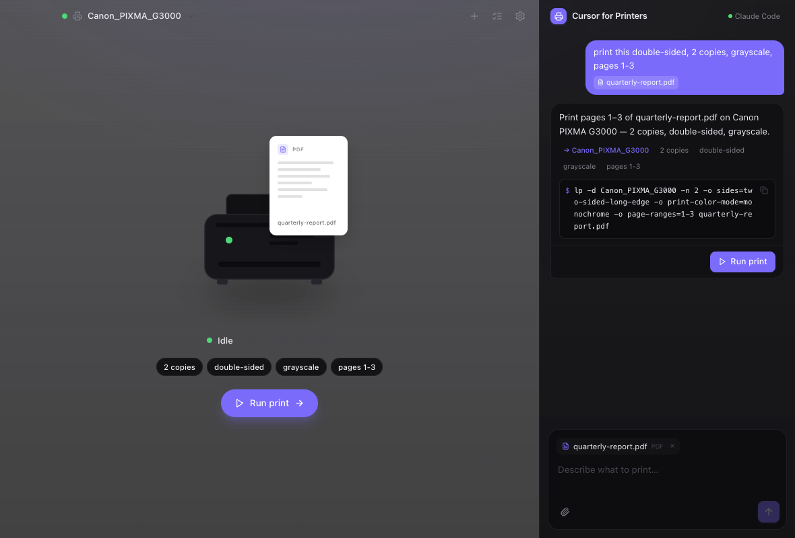
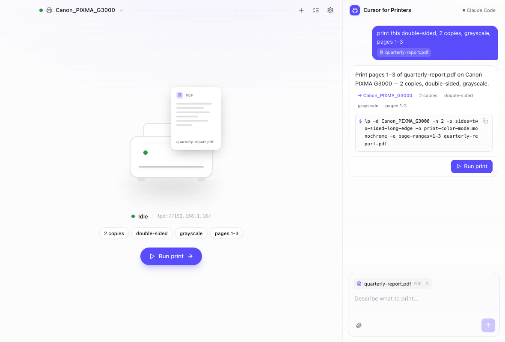
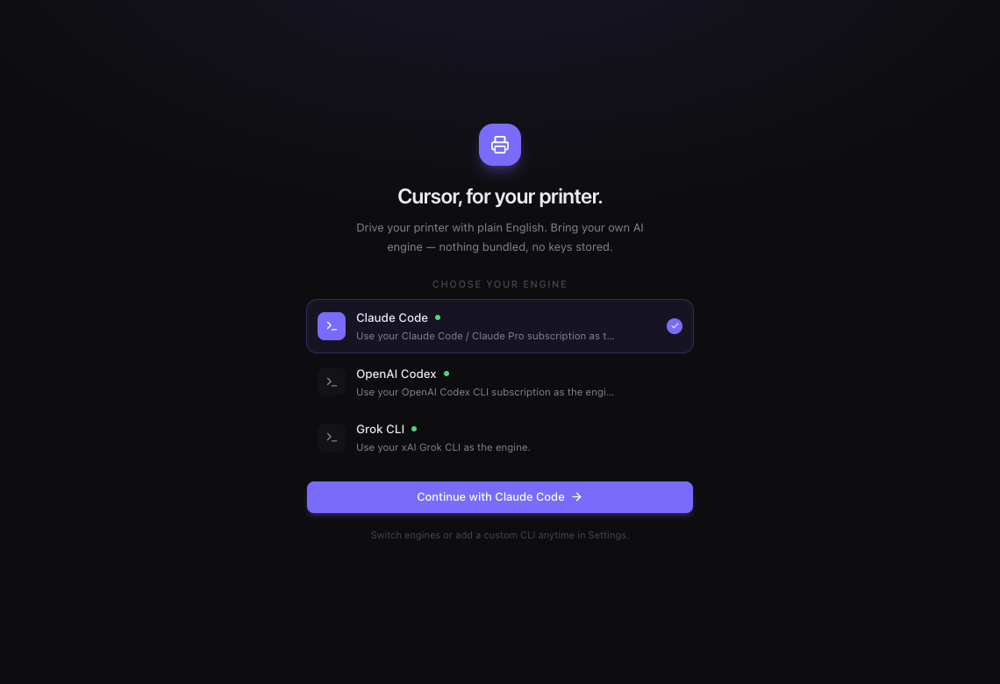
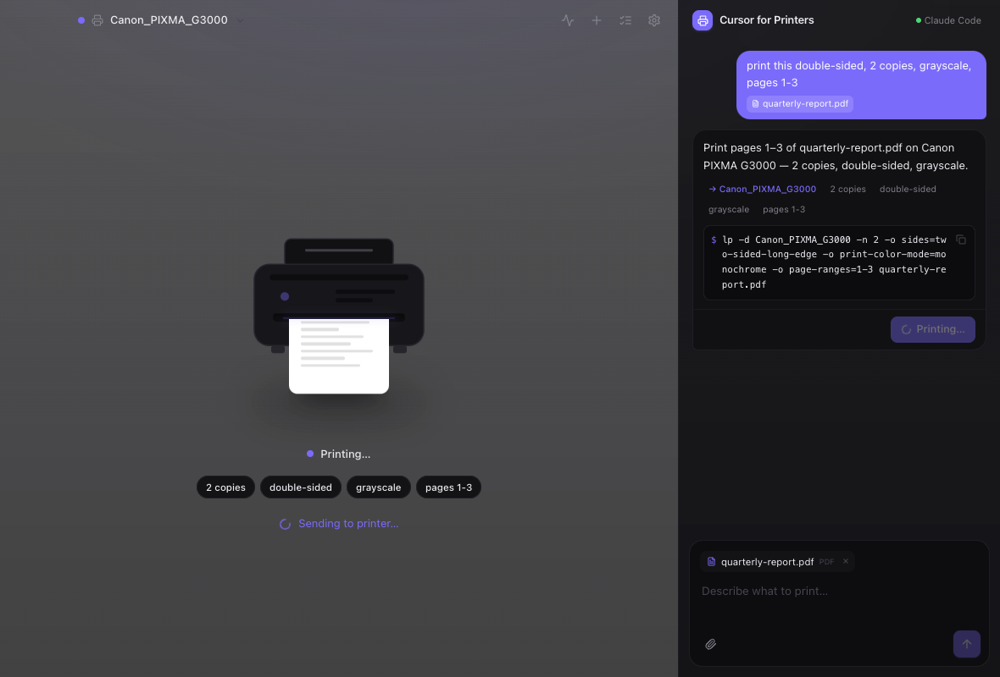
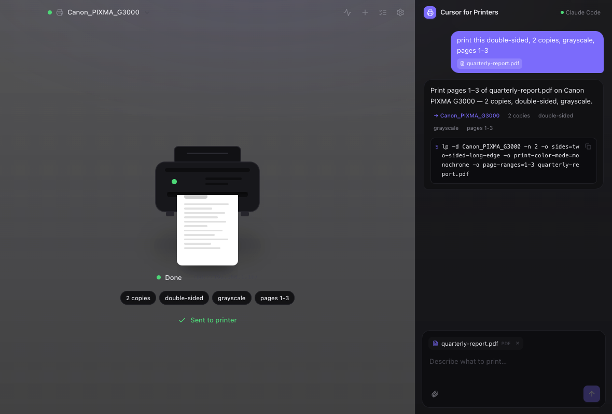
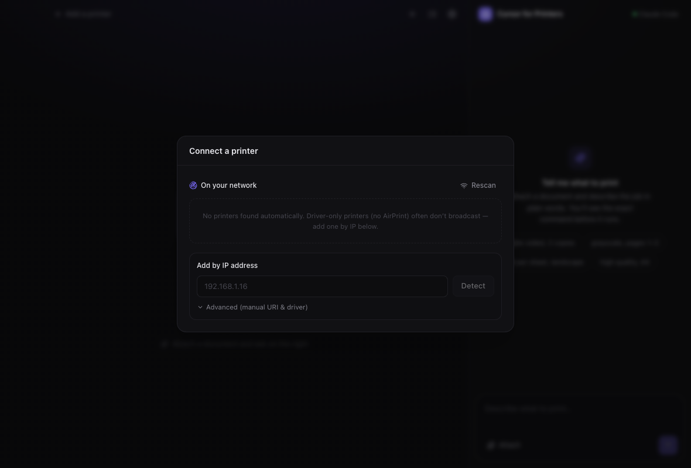
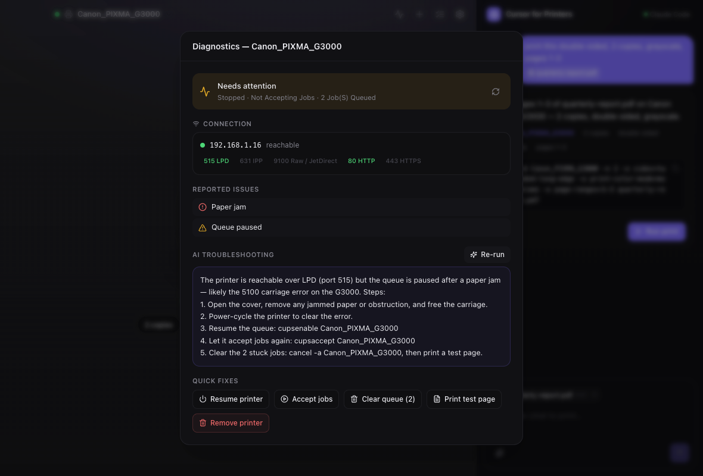

# Cursor for Printers

**Cursor, but for your printer.** A clean, minimal desktop app that lets you drive your
printer with plain English — powered by *your own* AI coding subscription.

You bring the engine (Claude Code, OpenAI Codex, Grok, or any CLI you already pay for).
The app never bundles a model and never stores keys. You type what you want, the engine
resolves it to structured print options, and the app turns those into an **exact `lp`
command that you approve before anything is sent to the printer**.

<p align="center">
  
</p>
<p align="center">
  
  
</p>

A **chat column** (Cursor-style) on the right; the rest is a **visual, animated stage**
that shows the printer, the document you selected floating above it, the resolved print
settings as chips, and live printer state. When you run a job the sheet feeds in and the
printed page **emerges from the front slot, revealing its content top-first** the way a
real printer lays down ink. Native macOS vibrancy, SF Pro, hairline depth — it aims to
feel like a SwiftUI app.

<p align="center">
  
  
</p>

The print animation is hand-built with **framer-motion** + an SVG slot-clip (no external
asset), so it matches the printer exactly and is driven by the real job status rather than
a canned playback — see `src/renderer/src/components/PrinterScene.tsx`.

---

## Why this design

Printing is a place where "the AI just did something" is not good enough — a wrong option
wastes paper, ink, and time. So the trust model is deliberate:

```
natural language  →  AI engine  →  structured options (JSON)  →  deterministic lp command  →  you approve  →  print
```

- The AI is only allowed to produce a **whitelisted set of options** (copies, sides,
  color, quality, media, page ranges, pages-per-sheet, collate, orientation, fit-to-page).
- The app **deterministically** maps those to an `lp` invocation — raw model text is never
  executed, and unknown fields are dropped with a warning.
- The **exact command is shown** before it runs, e.g.:

  ```
  lp -d Canon_PIXMA_G3000 -n 2 -o sides=two-sided-long-edge -o print-color-mode=monochrome -o page-ranges=1-3 report.pdf
  ```

- Every command is run with an explicit `argv` array (never a shell string), so there is
  no command-injection surface.

## Features (v1)

- **Onboarding** — auto-detects installed engines (`claude`, `codex`, `grok`) on your
  `PATH`, or add any custom CLI. Test the connection in one click.
- **Chat** — a Cursor-style conversation: attach a file, describe the job, and the engine
  replies with the resolved command (summary + exact `lp` line + a Run button).
- **Visual stage** — the printer, the selected document, the resolved settings (copies,
  duplex, color, pages…) and live state, laid out and animated. Run a job and the sheet
  feeds into the printer while the status light pulses.
- **Printer switcher** — pick your printer from the toolbar; that also sets your default
  (per-user, no admin needed).
- **Add a printer** — Bonjour/mDNS discovery for AirPrint devices, plus manual add-by-IP
  for driver-only printers. Driver selection is done correctly (see below).
- **Job queue** — see active jobs across all printers and cancel them; auto-refreshes.
- **Native feel** — macOS vibrancy, light + dark, SF Pro, hairline depth.

## How printing works (macOS / CUPS)

Everything routes through CUPS, the standard macOS print system:

| Action            | Command                                                        |
| ----------------- | -------------------------------------------------------------- |
| Discover / status | `lpstat -l -p`, `lpstat -v`, `lpstat -a`, `lpstat -d`          |
| Network discovery | `dns-sd -B _ipp._tcp` (and `_ipps`, `_printer`, `_pdl-datastream`) |
| Submit a job      | `lp -d <printer> -n <copies> -o <opts…> <file>`                |
| Job queue         | `lpstat -W not-completed -o`                                   |
| Cancel a job      | `cancel <printer>-<job>`                                       |
| Set default       | `lpoptions -d <printer>` (per-user, no `sudo`)                 |
| Add a queue       | `lpadmin -p <name> -E -v <uri> …`                              |

## Connect & diagnose

<p align="center">
  
  
</p>

- **Connect** — auto-scans the network (Bonjour/mDNS), resolves each device's model and
  capabilities from its TXT record, TCP-probes its print ports to show what's actually
  reachable, and connects in one click with the right driver. Driver-only printers are
  added by IP with automatic protocol/driver detection.
- **Diagnose** — for any printer: a reachability check (per-port TCP probes), CUPS state
  reasons translated to plain English (paper jam, out of ink, offline, paused…), the queue
  depth, and one-click fixes (resume, accept jobs, clear queue, print a test page, remove).
  **Ask your AI engine to explain and fix** feeds the diagnostics to your engine for a
  plain-English diagnosis — it even knows the Canon G-series lamp/5100 error codes.

### Add-printer driver logic (important)

Not every printer speaks AirPrint. The app picks the right driver strategy:

1. **IPP Everywhere (driverless)** — used *only* when the device advertises `ipp`/`ipps`
   over Bonjour. `lpadmin -m everywhere` requires a real IPP endpoint.
2. **Installed vendor PPD** — for driver-only printers (no IPP). The app scans installed
   PPDs and matches by make/model, then adds with `lpadmin -P <ppd>`.
3. **No driver found** — prompts you to install the vendor CUPS driver, then retry.

> Example: the Canon PIXMA G3000 is **LPD-only (port 515), no AirPrint**. The correct add is
> a vendor PPD, not IPP Everywhere:
>
> ```bash
> lpadmin -p Canon_PIXMA_G3000 -E -v lpd://192.168.1.16/ \
>   -P "/Library/Printers/PPDs/Contents/Resources/Canon G3000 series.ppd.gz"
> ```
>
> Adding a queue may require admin rights; if `lpadmin` reports it's not authorized, the
> app shows you the exact `sudo lpadmin …` line to run in Terminal.

## Setup

Requirements: macOS, Node ≥ 20 (built/tested on Node 26), and at least one AI CLI on your
`PATH` (`claude`, `codex`, or `grok`) — or bring your own.

```bash
npm install      # installs deps + downloads the Electron runtime
npm run dev      # launches the app (hot-reload)
```

Other scripts:

```bash
npm run build      # bundle main / preload / renderer into out/
npm run start      # preview the production build
npm run typecheck  # type-check both the node and web sides
npm run package    # build an unpacked .app (electron-builder --dir)
```

## Bring-your-own engine

An engine is just a CLI that takes a prompt and prints a response. Built-in presets:

| Engine        | Command invoked                          |
| ------------- | ---------------------------------------- |
| Claude Code   | `claude -p "{PROMPT}" --output-format json` |
| OpenAI Codex  | `codex exec --skip-git-repo-check "{PROMPT}"` |
| Grok CLI      | `grok -p "{PROMPT}"`                     |
| Custom        | any `bin` + args containing `{PROMPT}`   |

The `{PROMPT}` token is replaced with the full request; nothing is sent anywhere except
through the CLI you chose, using *your* authenticated subscription.

## Architecture

```
src/
  shared/            types + IPC channel names + provider presets (imported by all sides)
  main/              Electron main process
    index.ts         window, theme, IPC handlers
    cups.ts          discover / status / queue / submit / cancel / add-printer (+ driver logic)
    discovery.ts     Bonjour/mDNS browse + resolve via dns-sd
    providers.ts     detect + invoke engine CLIs
    nl.ts            prompt → engine → interpretation → deterministic lp command
    lp-builder.ts    whitelisted PrintOptions → validated `lp` argv (the safety core)
    exec.ts          execFile wrapper (argv only, PATH-hardened)
    store.ts         config persistence in userData
  preload/           contextBridge API (typed window.api)
  renderer/          React + Tailwind + framer-motion UI
    studio.tsx       shared state controller (files, printers, chat, status) via context
    components/
      ChatDock.tsx     the Cursor-style chat column
      Stage.tsx        the visual stage (toolbar, scene, settings chips, state)
      PrinterScene.tsx animated SVG printer + document + printing animation
      Onboarding · Settings · AddPrinterModal · QueueModal · toast · ui
```

## Testing the pipeline

`scripts/smoke.ts` runs a real request through the actual `nl` + `lp-builder` source and
asserts the resolved command. Example (using Claude Code as the engine):

```bash
claude -p "$(cat prompt.txt)" --output-format json > raw.json
./node_modules/.bin/esbuild scripts/smoke.ts --bundle --platform=node --format=esm --outfile=/tmp/smoke.mjs
node /tmp/smoke.mjs raw.json
# → COMMAND : lp -d Canon_PIXMA_G3000 -n 2 -o sides=two-sided-long-edge -o print-color-mode=monochrome -o page-ranges=1-3 report.pdf
# → PASS ✓
```

## Status & notes

- v1 is runnable and the full NL→command→approve→execute path is verified end-to-end
  against the real Claude Code CLI.
- Physical printing is intentionally gated behind your explicit **Run** click.
- A live physical print test against the Canon G3000 needs to run on a machine on the same
  LAN as the printer (a printer at `192.168.1.16` is only reachable from that home network).

## License

MIT
